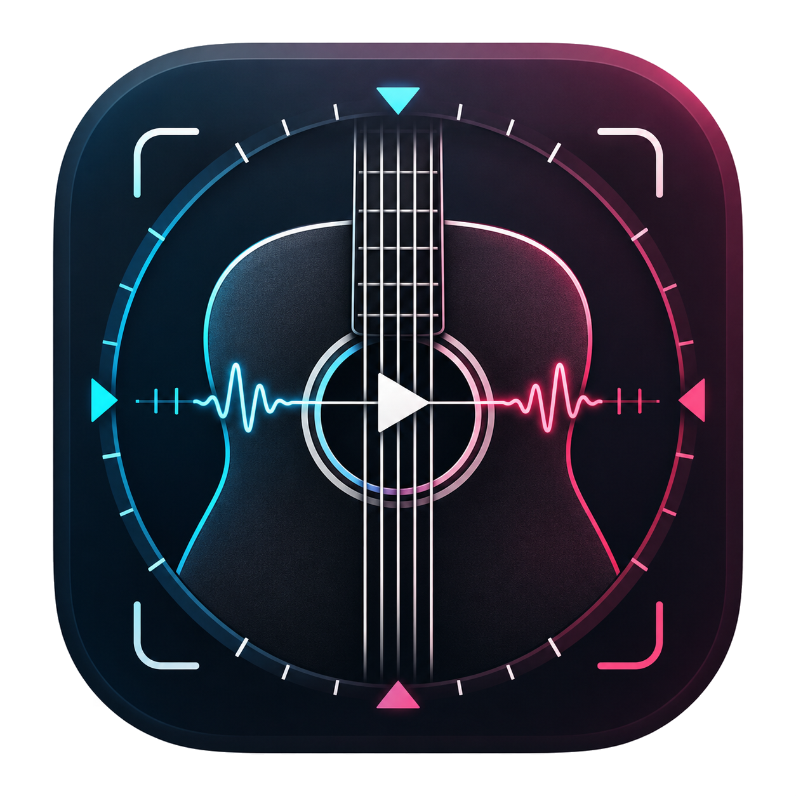
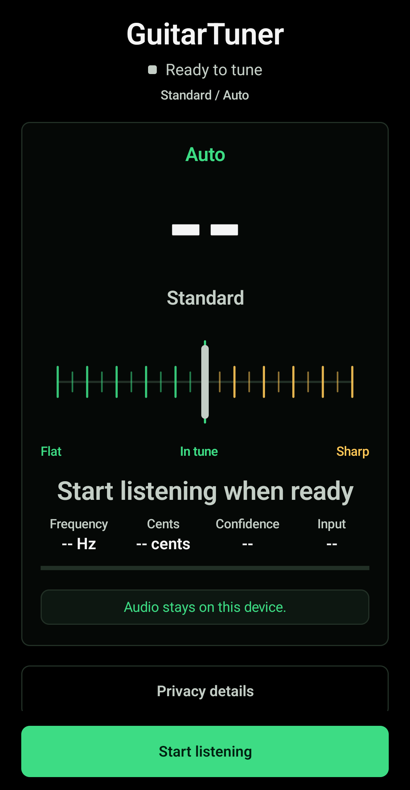
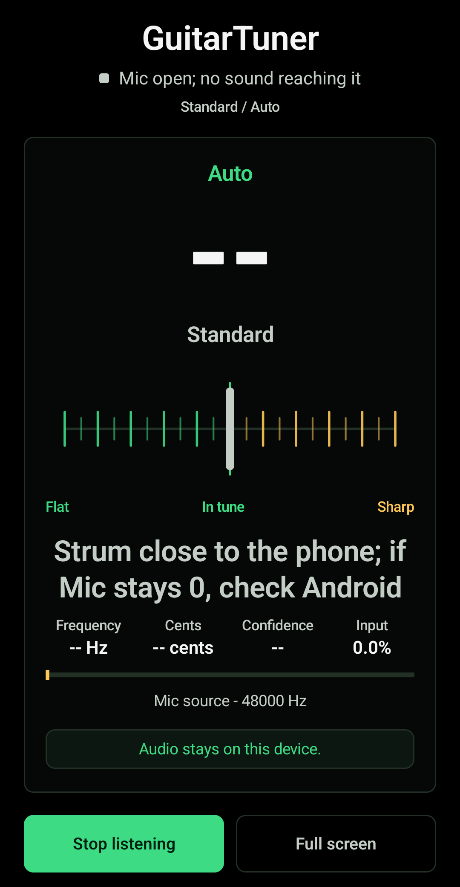
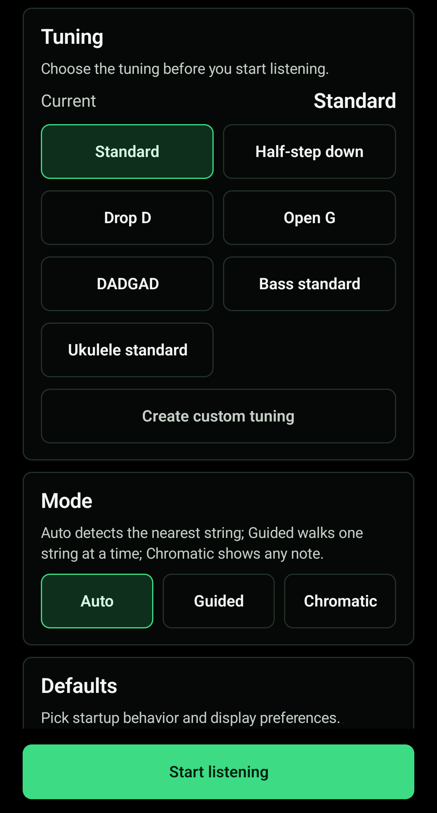

# GuitarTuner

<p align="center">
  
</p>


<p align="center">
  <a href="https://ko-fi.com/X8K126YVER">
    
  </a>
</p>

<p align="center">
  <sub><em>If this project helps you, a coffee helps me keep working on it.</em></sub>
</p>

GuitarTuner is an open-source Android tuner for acoustic guitar. It listens through the microphone, works out which open string you played, and tells you whether it's flat or sharp and which way to turn the peg. Everything runs on the phone. There are no accounts or ads, and the app doesn't have network permission.

<p align="center">
  
  
  
</p>

## Features

- Auto, Guided and Chromatic modes. Guided walks you from low E to high E and moves to the next string once the current one holds in tune.
- Guitar, bass and ukulele presets plus Drop D, Open G, DADGAD and half-step down.
- Custom tunings with 1 to 12 strings. Build them in the app or import them as JSON.
- A normal or strobe meter, a fullscreen stage view and a pitch history timeline.
- Capo from fret 0 to 12, A4 calibration in 0.1 Hz steps, and adjustable cents tolerance and noise gate.
- Reference tones, spoken feedback, haptic confirmation and a left-handed layout.
- Scientific (E2) or solfege (Mi2) note names.
- TalkBack support, with the app translated into English, German, Spanish, Portuguese, French, Japanese, Korean and Simplified Chinese.
- AMOLED dark theme by default, with light and system options.

## Install

You need Android 8.0 or newer.

1. Download the APK from the [latest release](https://github.com/SysAdminDoc/GuitarTuner/releases/latest).
2. Open it on your phone. If Android asks, let your browser or file manager install unknown apps.
3. Later releases install over the top and keep your settings.

## Verify the download

Each release ships a `SHA256SUMS.txt`. Compare it against the APK you downloaded:

```bash
sha256sum -c SHA256SUMS.txt
```

On Windows, `Get-FileHash <file>.apk -Algorithm SHA256` gives the same hash.

The APK is signed with this certificate (SHA-256):

```
DB:A1:AA:88:E3:7B:90:15:5F:CA:31:35:CA:3B:78:1D:E9:2C:22:51:07:E4:7C:98:06:E7:5B:F8:80:55:FD:D8
```

`apksigner verify --print-certs <file>.apk` prints it.

## Use

Tap **Start listening**, pluck one open string and turn the peg the way the tuner says (tune up or tune down). Pick a tuning before you start if you aren't in standard. Long-pressing the launcher icon gives you a Quick tune shortcut that starts listening straight away.

If the level reads `Mic 0.0% / peak 0.0%` while listening, Android is handing the app silence. Check the microphone privacy toggle, the app's microphone permission, and whether another app is holding the mic. If the peak moves but no string shows up, sound is getting through, so move closer, play one string at a time, or lower the noise gate.

Emulator audio isn't reliable for this. Test on a real phone.

## Custom tuning JSON

The Import button takes a file shaped like this:

```json
{
  "schemaVersion": 1,
  "tunings": [
    {
      "id": "custom_open_g",
      "name": "Open G",
      "strings": [
        { "stringNumber": 6, "name": "D", "note": "D2", "frequencyHz": 73.42 },
        { "stringNumber": 5, "name": "G", "note": "G2", "frequencyHz": 98.0 },
        { "stringNumber": 4, "name": "D", "note": "D3", "frequencyHz": 146.83 },
        { "stringNumber": 3, "name": "G", "note": "G3", "frequencyHz": 196.0 },
        { "stringNumber": 2, "name": "B", "note": "B3", "frequencyHz": 246.94 },
        { "stringNumber": 1, "name": "D", "note": "D4", "frequencyHz": 293.66 }
      ]
    }
  ]
}
```

## Privacy

The manifest asks for `RECORD_AUDIO` and nothing else. Audio is analyzed in memory while the tuner is on screen and is never saved or uploaded. Settings and custom tunings stay on the phone and go away when you clear the app's data or uninstall it.

## Build

You'll need JDK 21 and Android SDK platform 36. The Gradle wrapper handles the rest.

```powershell
$env:JAVA_HOME = "<path to JDK 21>"
$env:ANDROID_HOME = "$env:LOCALAPPDATA\Android\Sdk"
.\gradlew.bat check assembleDebug
```

For a signed release build, set `GUITARTUNER_KEYSTORE_PATH`, `GUITARTUNER_KEYSTORE_PASSWORD`, `GUITARTUNER_KEY_ALIAS` and `GUITARTUNER_KEY_PASSWORD`, then run `.\gradlew.bat assembleRelease`. Without those four, Gradle still finishes but writes an unsigned `app-release-unsigned.apk`.

`.\gradlew.bat :app:cyclonedxBom` writes a CycloneDX bill of materials.

## Credits

Pitch detection is built on the YIN algorithm by Alain de Cheveigné and Hideki Kawahara (2002).

## License

MIT. See [LICENSE](LICENSE).
